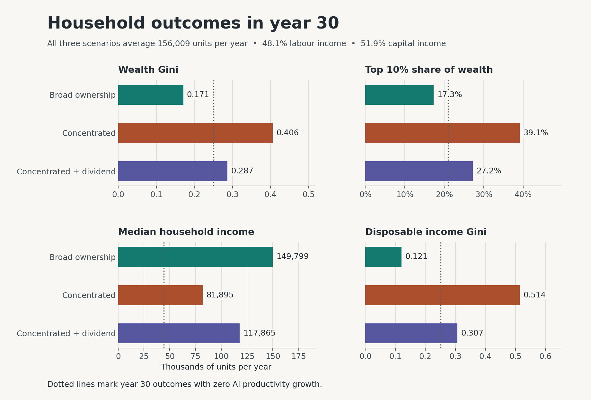

# AI productivity, ownership and inequality

**An exploratory household simulation. Its inputs are illustrative and its outputs are not forecasts.**

If AI raises productivity, how much does it matter who owns AI capital? This Python model follows 1,000 households for 30 years under equal ownership, concentrated ownership, and concentrated ownership with an equal per-household dividend. The three cases share the same productivity path and wage–capital split. A two-input sensitivity analysis shows when concentrated ownership makes a larger difference.

[Read the research note](research_note.md) · [View annual metrics](figures/annual_metrics.csv) · [View the sensitivity grid](figures/sensitivity.csv)



## Run locally

Use Python 3.10–3.13. The commands below use a virtual environment on macOS or Linux.

```sh
python3 -m venv .venv
.venv/bin/python -m pip install -r requirements.txt
.venv/bin/python run_analysis.py
```

On Windows, create the environment with `py -m venv .venv` and replace `.venv/bin/python` with `.venv\Scripts\python.exe` in the remaining commands. The script prints the year-30 results and regenerates the saved PNG and CSV files in `figures/`. It runs headlessly and needs no data downloads after dependencies are installed.

## Assumptions

| Input | Value and interpretation |
| --- | --- |
| Households and years | 1,000 equally weighted households and 30 annual income and saving periods. Year 0 reports initial wealth and pre-AI wages before any saving. |
| Random seed | 42, using NumPy's default random generator. All runs reuse the same households. |
| Initial wealth | Independent log-normal draws with median 80,000 units and log standard deviation 1.0. |
| Baseline annual wages | Independent log-normal draws with median 45,000 units and log standard deviation 0.45. Initial wealth and wage draws are independent. |
| AI productivity | 4% compound growth per year from the pre-AI output level. Output in the no-AI reference stays at the pre-AI level. |
| Capital share of AI gains | 75% in all three main scenarios. The remaining 25% goes to wages in proportion to each household's baseline wage. |
| Broad ownership | Every household gets an equal claim on gross AI capital income. The initially wealthiest 100 households together own 10%. |
| Concentrated ownership | The initially wealthiest 100 households own 90% of AI capital, with equal shares within this group. The other 900 households each get an equal part of the remaining 10%. These claims are fixed. |
| Concentrated + dividend | The same concentrated ownership. Each year, 50% of gross AI capital income is paid equally to all 1,000 households. Owners receive the other 50% in proportion to their shares. |
| Saving | Every household banks 20% of annual disposable income and consumes the remainder. Savings earn zero interest. Wealth is initial wealth plus cumulative savings and excludes the value of AI ownership claims. |

All monetary values use constant, arbitrary units. The model has no pre-existing capital income, so pre-AI aggregate output equals the sum of baseline wages. The economy and population have no other sources of growth or income. Ownership represents access to AI profits. The model gives households a common productivity path, with baseline wages determining how much of the wage gain each receives.

## Annual accounting

1. The extra output in year `t` is the sum of starting wages multiplied by `(1 + productivity_growth)**t - 1`.
2. The capital fraction times extra output is the gross capital pool. The remaining extra output is added to baseline wages in proportion to each household's share of the initial wage bill.
3. Each household's disposable income is wages plus its fixed ownership share of the capital pool after the dividend, plus the equal dividend payment. The dividend is funded entirely by the capital pool, so total household income equals total output.
4. End-of-year wealth adds the year's savings to previously accumulated wealth. The wealthiest 100 households are ranked again at each observation for the top 10% wealth statistic. Ownership always uses the initial ranking.

The Gini measures dispersion on a 0–1 scale, with zero denoting equality. The income Gini uses disposable household income, including the dividend. Labour and capital shares use the source of income before redistribution, and the dividend retains its origin in capital income. The mean and median describe annual disposable household income.

## Outputs

| File | Contents |
| --- | --- |
| [Trajectories](figures/01_trajectories.png) | Annual wealth Gini, top 10% wealth share, average income, and gross labour and capital shares. The shared income and factor-share paths are shown once. |
| [Year-30 comparison](figures/02_year_30_comparison.png) | Wealth Gini, top 10% wealth share, median income, and disposable income Gini. Dotted lines show the no-AI reference at the same horizon. |
| [Sensitivity](figures/03_sensitivity.png) | Wealth Gini gaps with and without the fixed 50% dividend. The axes vary the share of capital owned by the initial top 10% (10%, 30%, 50%, 70%, 90%, 100%) and the share of AI gains going to capital (25%, 50%, 75%, 100%). Each benchmark uses equal ownership and the same capital share of gains as its comparison. |
| [Annual metrics](figures/annual_metrics.csv) | One row per scenario and year, including the no-AI reference. |
| [Sensitivity results](figures/sensitivity.csv) | One row per pair of inputs. Includes year-30 Ginis, Gini gaps and top 10% wealth shares for each ownership or dividend arrangement. |

[simulation.py](simulation.py) contains the household model and default assumptions. [run_analysis.py](run_analysis.py) runs the comparisons and writes the tables and charts.
