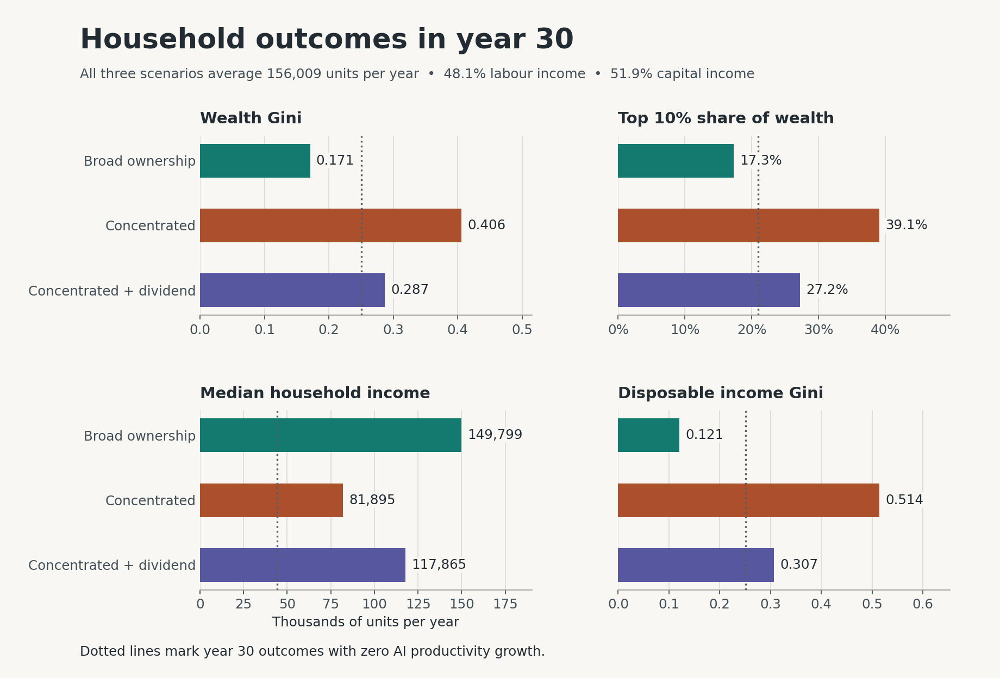

# Who gets the gains from AI productivity?

**An exploratory simulation, not a prediction.** The numbers come from an illustrative model of 1,000 households. They describe what follows from its assumptions over 30 years.

## 1. Research question

If AI substantially increases productivity, how do the shares going to workers and capital owners affect household income and wealth inequality? I compare three ways of allocating the same gains. In one, every household owns an equal share of AI capital. In another, the initially wealthiest tenth own most of it. In the third, ownership stays concentrated and households receive an equal dividend funded by AI capital income. I then ask how much the answer changes when capital receives a smaller share of the productivity gain.

## 2. Why the question matters

Average income alone tells us little about who gets a raise, builds savings or starts the next generation with assets. If AI raises the income paid to owners of productive assets, the distribution of ownership can affect who benefits even when wages rise. Moll, Rachel and Restrepo examine this channel in their research on automation, returns to wealth and the distribution of personal income. Trammell asks how far automation might reduce labour’s share of income and examines conditions under which labour could retain a substantial share. Together these questions motivate treating ownership and the wage–capital split as separate assumptions. [Moll, Rachel and Restrepo, 2022](https://cowles.yale.edu/research/cfp-1897-uneven-growth-automations-impact-income-and-wealth-inequality) · [Trammell, 2026](https://www.forethought.org/research/is-labor-a-luxury-in-the-long-run)

## 3. Model design and assumptions

The same 1,000 households start each run with log-normal draws for wealth and wages. The input medians are 80,000 units of wealth and 45,000 units of annual wages. Initial wealth and wages are drawn independently. Total starting wages define pre-AI output, and productivity grows by 4% a year from that level. In the three main scenarios, 75% of each year’s output gain over the pre-AI level goes to capital, with the remaining 25% added to wages in proportion to baseline pay.

Equal ownership gives each household the same claim on the capital income. Under concentrated ownership, the initially wealthiest 100 households split 90% of the claim equally, and the other 900 split the remainder. The dividend scenario redirects half of the gross capital income to an equal payment per household. All households save 20% of disposable income each year. Cash savings earn zero interest and leave ownership claims untouched. The model measures wealth as starting assets plus accumulated savings. A no-AI reference keeps productivity flat and lets households save their baseline wages for the same 30 years. [Full assumptions and accounting](README.md#assumptions)

## 4. Results

Average annual household income rises from 48,100 units to 156,009 in all three AI scenarios. The mean is identical because each scenario distributes the same pool of income. By year 30, labour accounts for 48.1% of total income and capital for 51.9%, measured before any dividend. The capital share of total income is lower than the 75% share of AI gains because baseline wages are still part of total income. [Annual results](figures/annual_metrics.csv) · [Time series](figures/01_trajectories.png)

| Year-30 outcome | Broad ownership | Concentrated | Concentrated + dividend | No AI |
| --- | ---: | ---: | ---: | ---: |
| Wealth Gini | 0.171 | 0.406 | 0.287 | 0.250 |
| Top 10% share of wealth | 17.3% | 39.1% | 27.2% | 20.9% |
| Median annual income, units | 149,799 | 81,895 | 117,865 | 44,122 |
| Disposable income Gini | 0.121 | 0.514 | 0.307 | 0.251 |

The sensitivity analysis varies how much of the AI capital the initial top tenth owns and how much of the productivity gain goes to capital. In each of the 20 settings with unequal ownership, the wealth Gini and top 10% wealth share are highest under concentrated ownership without a dividend, lower with a dividend and lowest under equal ownership. The size of the difference varies considerably. With the initial top tenth owning 90% of AI capital, the wealth Gini gap versus equal ownership is 0.073 when capital receives 25% of AI gains and 0.235 when it receives 75%. At the 75% setting, the dividend brings that gap down to 0.116. With the same ownership and dividend but only 25% going to capital, the year-30 wealth Gini is 0.248, just below the no-AI reference of 0.250. [Sensitivity heatmap](figures/03_sensitivity.png) · [Full grid](figures/sensitivity.csv)

## 5. Interpretation

The starting point and the no-AI reference answer different questions. In the concentrated scenario, the wealth Gini starts at 0.512, falls to 0.347 in year 13 and climbs back to 0.406 by year 30. Early on, households save from wages, which are much less unevenly distributed than initial wealth. As capital income grows, the concentrated payouts account for a larger part of new savings. Comparing year 30 with year 0 shows a decline in the Gini. Comparing it with year 30 without AI shows substantially more inequality. The top tenth’s wealth share also edges above its initial value by year 30, even as the Gini remains below its starting level.

There is a simple reason the dividend narrows the gap. If the initially wealthiest tenth owns 90% of AI capital, it gets 90% of gross capital income without a dividend. It receives 45% of the original pool through its ownership claims and 5% through the universal payment once half the pool is distributed equally. Its effective claim on the income falls to 50% while its legal ownership stays at 90%. In this model, giving a household the same stream of capital income through shares or dividends has the same effect on its savings. Which policies could actually sustain those streams is a separate question.

## 6. Limitations

The exercise accounts for income and savings under a fixed productivity path. It leaves out job loss, different exposure to AI across occupations, bargaining over wages, existing capital income, behavioural responses to redistribution and changes in prices. Every household uses the same saving rate. The combination of independent starting wealth and wages, no interest on savings and no legacy capital returns makes the no-AI reference equalise strongly. AI ownership claims have no resale value in the model. Counting their market value could heighten measured wealth concentration where claims are concentrated. The grid shows how the simulated mechanism behaves for one population and one growth path. Its parameter values are illustrative and are not estimates of likely future conditions.

## 7. Next steps

The next version should test one omission at a time. I would start by adding a pre-existing source of capital income and using household survey data to anchor the joint distribution of wealth and earnings. That would test how much the no-AI decline depends on the starting assumptions. A subsequent extension could assign a value to the AI ownership claims and track both the income they pay and the wealth they represent. That would help clarify when broader ownership and a dividend have different consequences, even if they deliver the same cash payments today.
